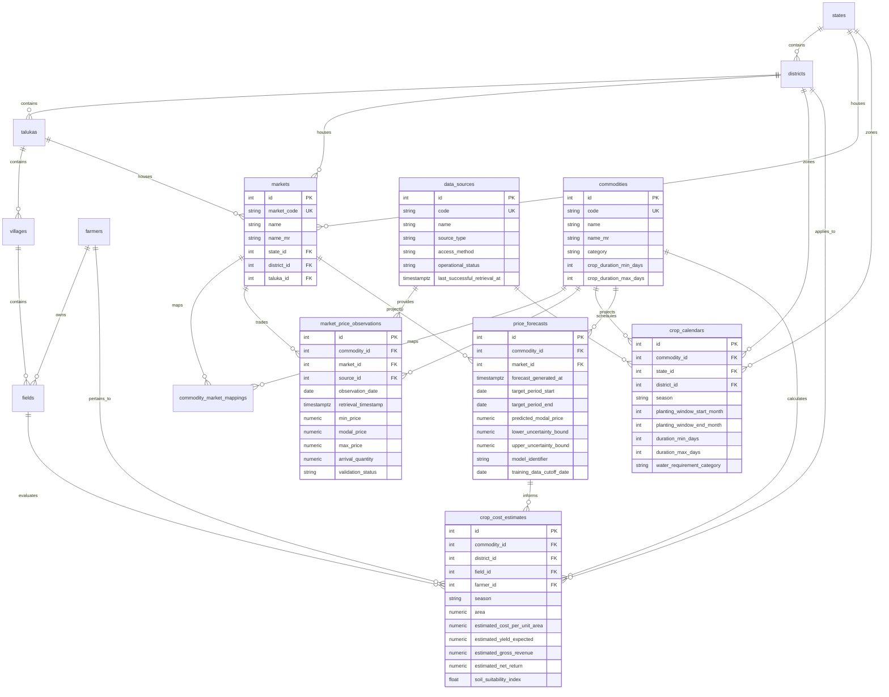

# SoilPilot — Market Intelligence & Crop Planner
## Phase 3 Database Design & Data Models Specification

---

## 1. Executive Summary & Audited Infrastructure

Following the Phase 1 technical audit and Phase 2 frontend integration, Phase 3 establishes the database foundation for the **Market Intelligence & Crop Planner** module.

### Audited Backend & Database Stack
- **ORM & Dialect:** SQLAlchemy 2.0 (`sqlalchemy.orm.DeclarativeBase`, typed `Mapped[...]`, `mapped_column`)
- **Primary Database Engine:** PostgreSQL 16 with PostGIS 3.4 (`postgis/postgis:16-3.4`)
- **Development Fallback Engine:** SQLite 3 (auto-initialized by `app/db/session.py` when PostgreSQL is unreachable)
- **Migration Framework:** Alembic 1.13+ / 1.20+ (`alembic/versions/`)
- **Spatial Support:** PostGIS `Geometry('MULTIPOLYGON', 4326)` on PostgreSQL with transparent WKT text fallback on SQLite

---

## 2. Architectural Principles & Safety Protocols

1. **Strict Non-Destructive Addition:** No existing tables (`states`, `districts`, `talukas`, `villages`, `farmers`, `fields`, `soil_reports`, `soil_parameter_values`, `gat_farmers`) are dropped, renamed, or altered.
2. **Preservation of Village-Scoped Gat Integrity:** A Gat number alone is **not** globally unique across Maharashtra; it is unique only within its respective village (`uq_field_village_gat`). Crop profitability estimates link directly to synthetic primary keys (`fields.id` and `farmers.id`) rather than duplicating raw Gat strings.
3. **Temporal Separation:** The actual date on which trading took place at an APMC yard (`observation_date`: `Date`) is strictly separated from the instant SoilPilot retrieved or ingested the record (`retrieval_timestamp`: `DateTime(timezone=True)`).
4. **Distinction Between Observations and Forecasts:** Actual historical market prices are stored in `market_price_observations`, while statistical projections are stored in `price_forecasts` with explicit model versioning, training cutoffs, and uncertainty bounds. A forecast is never labeled as an observed spot price.
5. **Configurable Crop Catalogue:** Rather than hardcoding 6 crops, the `commodities` entity supports dynamic crop categories (Cereals, Pulses, Oilseeds, Cash Crops, Vegetables, Fruits, Spices) with English and Marathi nomenclature.
6. **Honest Data Integrity:** All numeric prices enforce non-negativity (`>= 0`) and logical consistency (`min_price <= modal_price <= max_price`). Missing modal prices or arrival volumes are stored as `NULL` without fabricated substitutes.

---

## 3. Entity-Relationship Diagram (Mermaid)

---

## 4. Detailed Data Model Specifications

### 4.1. `data_sources` (`DataSourceRegistry`)
| Column | Type | Constraints | Description |
|---|---|---|---|
| `id` | INTEGER | PRIMARY KEY, AUTOINCREMENT | Internal synthetic identifier |
| `code` | VARCHAR(50) | NOT NULL, UNIQUE, INDEX | Unique source identifier (`AGMARKNET`, `MPKV_RAHURI`, `MSAMB`) |
| `name` | VARCHAR(150) | NOT NULL | Official name of data publishing authority |
| `source_type` | VARCHAR(50) | NOT NULL | Category (`GOVERNMENT_PORTAL`, `STATE_APMC_BOARD`, `AGRICULTURAL_UNIVERSITY`) |
| `official_url` | VARCHAR(255) | NULLABLE | Authoritative portal or documentation endpoint |
| `access_method` | VARCHAR(50) | NOT NULL, DEFAULT `'REST_API'` | Channel (`REST_API`, `OPEN_DATA_PORTAL`, `CSV_PUBLICATION`, `BULLETIN`) |
| `licensing_notes`| TEXT | NULLABLE | NDSAP / Open Data license terms |
| `update_frequency`| VARCHAR(50)| NOT NULL, DEFAULT `'DAILY'` | Bulletin cadence (`DAILY`, `WEEKLY`, `SEASONAL`) |
| `last_successful_retrieval_at` | TIMESTAMPTZ | NULLABLE | Timestamp of last verified 200 OK harvest |
| `last_attempted_retrieval_at` | TIMESTAMPTZ | NULLABLE | Timestamp of last attempted network synchronization |
| `operational_status` | VARCHAR(30) | NOT NULL, DEFAULT `'PENDING_INTEGRATION'` | Health status (`ACTIVE`, `PENDING_INTEGRATION`, `DEGRADED`, `SUSPENDED`) |
| `is_active` | BOOLEAN | NOT NULL, DEFAULT true | Administrative liveness toggle |
| `created_at` / `updated_at` | TIMESTAMPTZ | NOT NULL | Audit timestamps |

### 4.2. `commodities` (`Commodity`)
| Column | Type | Constraints | Description |
|---|---|---|---|
| `id` | INTEGER | PRIMARY KEY, AUTOINCREMENT | Internal synthetic identifier |
| `code` | VARCHAR(50) | NOT NULL, UNIQUE, INDEX | Universal crop code (`SOYBEAN`, `ONION`, `COTTON`, `GRAM`, `WHEAT`, `SUGARCANE`) |
| `name` | VARCHAR(100) | NOT NULL, INDEX | English commodity display name |
| `name_mr` | VARCHAR(100) | NOT NULL, INDEX | Marathi localized name (`सोयाबीन`, `कांदा`, `कापूस`, `हरभरा`, `गहू`) |
| `category` | VARCHAR(50) | NOT NULL, INDEX | Category (`OILSEEDS`, `VEGETABLES`, `PULSES`, `CEREALS`, `CASH_CROPS`) |
| `botanical_name` | VARCHAR(100) | NULLABLE | Taxonomic binomial (e.g. *Glycine max*) |
| `standard_unit` | VARCHAR(20) | NOT NULL, DEFAULT `'QUINTAL'` | Base reporting unit (`QUINTAL` = 100 kg, `KG`, `TONNE`) |
| `crop_duration_min_days` | INTEGER | NULLABLE | Minimum vegetative-to-maturity duration |
| `crop_duration_max_days` | INTEGER | NULLABLE | Maximum vegetative-to-maturity duration |
| `description` / `description_mr` | TEXT | NULLABLE | Bilingual agronomic descriptions |
| `is_active` | BOOLEAN | NOT NULL, DEFAULT true | Liveness flag |

*Check Constraints:*
- `chk_commodity_duration_valid`: `crop_duration_min_days <= crop_duration_max_days`

### 4.3. `markets` (`MarketApmc`)
| Column | Type | Constraints | Description |
|---|---|---|---|
| `id` | INTEGER | PRIMARY KEY, AUTOINCREMENT | Internal synthetic identifier |
| `market_code` | VARCHAR(50) | NOT NULL, UNIQUE, INDEX | Mandi identifier (`MH_BARAMATI_APMC`, `MH_PUNE_GULTEKDI`, `MH_LASALGAON`) |
| `name` | VARCHAR(150) | NOT NULL, INDEX | Official APMC title |
| `name_mr` | VARCHAR(150) | NOT NULL | Localized Marathi market title |
| `state_id` | INTEGER | NOT NULL, FK -> `states(id)` ON DELETE RESTRICT | Owning administrative state (Maharashtra) |
| `district_id` | INTEGER | NOT NULL, FK -> `districts(id)` ON DELETE RESTRICT | Owning administrative district (e.g. Pune) |
| `taluka_id` | INTEGER | NULLABLE, FK -> `talukas(id)` ON DELETE SET NULL | Physical taluka jurisdiction (e.g. Baramati) |
| `agmarknet_market_id` | VARCHAR(50) | NULLABLE, INDEX | AGMARKNET official mandi reference code |
| `market_type` | VARCHAR(50) | NOT NULL, DEFAULT `'PRINCIPAL_MARKET'` | Yard status (`PRINCIPAL_MARKET`, `SUB_YARD`, `PRIVATE_MARKET`) |
| `latitude` / `longitude` | FLOAT | NULLABLE | WGS84 geographic coordinates of the trading yard |

### 4.4. `commodity_market_mappings` (`CommodityMarketMapping`)
Resolves idiosyncratic bulletin nomenclature to canonical commodities (e.g. "Onion Red / Nashik" -> `ONION`).
- Composite Unique Constraint: `UNIQUE(market_id, source_commodity_name, source_variety_name)`

### 4.5. `market_price_observations` (`MarketPriceObservation`)
| Column | Type | Constraints | Description |
|---|---|---|---|
| `id` | INTEGER | PRIMARY KEY, AUTOINCREMENT | Internal observation identifier |
| `commodity_id` | INTEGER | NOT NULL, FK -> `commodities(id)` ON DELETE RESTRICT | Canonical commodity reference |
| `market_id` | INTEGER | NOT NULL, FK -> `markets(id)` ON DELETE RESTRICT | Reporting APMC market reference |
| `source_id` | INTEGER | NOT NULL, FK -> `data_sources(id)` ON DELETE RESTRICT | Originating source reference (e.g. Agmarknet) |
| `source_record_id` | VARCHAR(100) | NULLABLE, INDEX | Source-provided bulletin record ID or hash |
| `observation_date` | DATE | NOT NULL, INDEX | **Trading Date** on which prices were realized |
| `retrieval_timestamp`| TIMESTAMPTZ | NOT NULL | **Ingestion Timestamp** when harvested by SoilPilot |
| `min_price` | NUMERIC(10,2)| NULLABLE | Minimum price in ₹ |
| `modal_price` | NUMERIC(10,2)| NULLABLE | Modal (most frequent) price in ₹ |
| `max_price` | NUMERIC(10,2)| NULLABLE | Maximum price in ₹ |
| `currency` | VARCHAR(10) | NOT NULL, DEFAULT `'INR'` | Currency code (Indian Rupee) |
| `price_unit` | VARCHAR(30) | NOT NULL, DEFAULT `'RS_PER_QUINTAL'` | Normalized unit basis |
| `arrival_quantity`| NUMERIC(12,2)| NULLABLE | Traded physical arrival volume |
| `arrival_unit` | VARCHAR(30) | NULLABLE, DEFAULT `'TONNE'` | Arrival measurement unit |
| `raw_payload` | JSON | NULLABLE | Original raw payload fragment for audit reproducibility |
| `validation_status`| VARCHAR(30) | NOT NULL, DEFAULT `'PENDING'` | Quality gate (`VERIFIED`, `PENDING`, `FLAGGED_OUTLIER`, `SUSPECT_INVERTED`) |

*Check Constraints:*
- `chk_price_min_nonnegative`: `min_price >= 0`
- `chk_price_max_nonnegative`: `max_price >= 0`
- `chk_price_modal_nonnegative`: `modal_price >= 0`
- `chk_arrival_nonnegative`: `arrival_quantity >= 0`
- `chk_price_min_lte_max`: `min_price <= max_price`
- `chk_price_min_lte_modal`: `min_price <= modal_price`
- `chk_price_modal_lte_max`: `modal_price <= max_price`

### 4.6. `crop_calendars` (`CropCalendar`)
Represents regional agro-climatic planting windows, durations, and water/labor requirements.
- Linked to `commodities`, `states`, and optionally `districts` and `talukas`.
- Supports seasons: `KHARIF`, `RABI`, `ZAID_SUMMER`, `ANNUAL`, `PERENNIAL`.
- Captures planting window month/day ranges (e.g. June 15 to July 15 for Kharif Soybean).
- Stores `water_requirement_category` (`LOW`, `MEDIUM`, `HIGH`, `VERY_HIGH`) and `labor_intensity`.

### 4.7. `price_forecasts` (`PriceForecast`)
Stores future harvest-period price projections generated by analytical models.
- Separated from observations; records `forecast_generated_at`, `target_period_start`, and `target_period_end`.
- Stores `predicted_modal_price`, `lower_uncertainty_bound`, and `upper_uncertainty_bound` (₹/Quintal).
- Records `model_identifier` (e.g. `PROPHET_APMC_SEASONAL`), `model_version`, and `training_data_cutoff_date`.
- Check Constraint: `lower_uncertainty_bound <= predicted_modal_price <= upper_uncertainty_bound`.

### 4.8. `crop_cost_estimates` (`CropCostEstimate`)
Prepares calculation schemas for farm-level economics:
- Links to `commodities`, `districts`, and optionally `fields(id)` and `farmers(id)` for field-specific suitability.
- JSON `cost_breakdown` (land preparation, seeds, fertilizers, irrigation, labor, plant protection, harvesting).
- Yield metrics: `estimated_yield_min`, `estimated_yield_max`, `estimated_yield_expected` (Quintals/Ha).
- Revenue and net return estimates linked to `price_forecasts(id)`.
- Agronomic suitability: `soil_suitability_index` (0.0 to 1.0, derived from SoilPilot Digital Soil Map rasters and Soil Health Card parameters in Phase 4).

---

## 5. Migration Strategy & Execution Plan

Alembic migration script:  
[`backend/alembic/versions/003_market_intelligence_and_crop_planner.py`](file:///c:/Users/Admin/Downloads/SoilPilot_texturetriangle-main/SoilPilot_texturetriangle-main/backend/alembic/versions/003_market_intelligence_and_crop_planner.py)

- **Revision ID:** `003_market_intelligence`
- **Down Revision:** `002_gat_farmers`
- **Backward Compatibility:** 100% additive. No existing tables, columns, or indexes are modified.
- **Downgrade Safety:** Reversible DDL cleanly drops the 8 newly created tables in reverse dependency order.

### Application Status
The migration has been compiled and validated for syntax and schema integrity. Since the active PostgreSQL container in the current environment is running from a legacy deployment (`soil_pranav_updation-main`), applying production DDL migrations requires administrative confirmation. The models run natively on SQLite fallback in development and testing.

---

## 6. Verification & Test Suite

Dedicated test suite:  
[`backend/tests/test_market_intelligence_models.py`](file:///c:/Users/Admin/Downloads/SoilPilot_texturetriangle-main/SoilPilot_texturetriangle-main/backend/tests/test_market_intelligence_models.py)

**Executed Test Cases (12/12 PASSED in 0.60s):**
1. `test_data_source_registry_creation`: Creation of source registries with operational statuses.
2. `test_data_source_unique_code`: Unique code enforcement on data source codes.
3. `test_commodity_creation_bilingual`: Bilingual naming and duration bounds on commodities.
4. `test_commodity_duration_constraint`: Rejection of inverted duration ranges.
5. `test_market_apmc_relationship_to_geography`: Relational links between APMCs and State/District/Taluka.
6. `test_commodity_market_mapping`: Variety and grade disambiguation mappings.
7. `test_market_price_observation_date_separation`: Strict separation between trading date and retrieval timestamp.
8. `test_market_price_logic_constraint_violation`: Integrity constraint rejection when `min_price > max_price`.
9. `test_crop_calendar_regional_context`: Seasonal planting windows and water/labor classifications.
10. `test_price_forecast_distinct_from_observations`: Model versioning and uncertainty bounds.
11. `test_crop_cost_estimate_field_linkage`: Relational linkage between cost estimates and cadastral fields/farmers.
12. `test_existing_entities_remain_protected`: Complete regression test verifying existing geographic, farmer, and field entities.

---

## 7. Roadmap to Phase 4

Phase 3 concludes the database schema and ORM models. Phase 4 will introduce:
- Ingestion connectors for AGMARKNET `data.gov.in` API (Resource ID `9ef84268-d588-465a-a308-a864a43d0070`).
- Background data sync pipelines with automated deduplication and outlier validation.
- Time-series price forecasting models and uncertainty estimation.
- Crop suitability scoring integrating SoilPilot DSM soil texture, pH, SOC, and nitrogen rasters.
